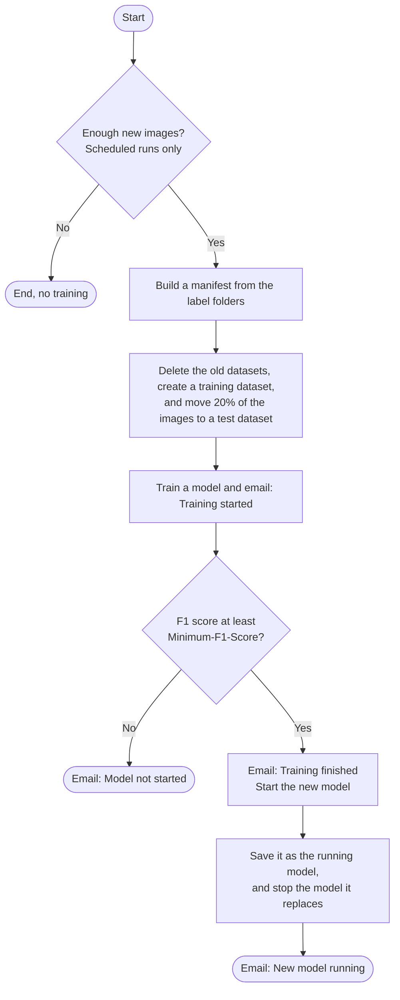

# 3. Model training

The training images are in S3, one folder per label, under `images_labeled_by_folder/`. The folder name is the label. This sample starts with five Amazon logos and five AWS logos, in `sample-images/amazon_logo` and `sample-images/aws_logo`, which train a model with the labels `amazon_logo` and `aws_logo`.

## Upload the training images

Run these commands from the repository folder, with the variables from [section 1](../1-Deployment/README.md#set-the-variables-for-the-next-sections) set.

```bash
for label in amazon_logo aws_logo; do
  aws s3 cp "sample-images/$label/" "s3://$BUCKET/images_labeled_by_folder/$label/" --recursive --exclude ".*"
done
aws s3 ls "s3://$BUCKET/images_labeled_by_folder/" --recursive
```

You should see 10 images in two folders. Only `.jpg`, `.jpeg`, and `.png` files directly inside a label folder are used. The workflow skips other files and deeper subfolders.

## Start a training run

The schedule checks for new images every 12 hours. To train now, start the training workflow yourself:

```bash
RUN=$(aws stepfunctions start-execution --state-machine-arn "$TRAINING" --query executionArn --output text)
echo "$RUN"
```

A run that you start yourself always trains, even if fewer than `Minimum-Untrained-Images` images were added and even if automatic training is off. It ends right away if another training run is in progress, because only one runs at a time.

## What the training workflow does



1. **Count the images.** A scheduled run continues only if automatic training is on and at least `Minimum-Untrained-Images` images were added since the last training run.
2. **Rebuild the datasets.** The workflow writes a manifest that labels each image with its folder name, deletes the project's old datasets, and creates a new training dataset from the manifest. Then it moves 20% of the images, from every label, into a new test dataset. Rebuilding takes about a minute.
3. **Train.** Training the sample's 10 images takes 15 to 20 minutes. You get a **Training started** email. The workflow checks on the training every 5 minutes. Rekognition writes the evaluation results to `evaluation/` in the bucket.
4. **Evaluate.** If the model's F1 score is at least `Minimum-F1-Score`, you get a **Training finished** email, and the workflow starts the model with `Minimum-Inference-Units` units. Starting a model takes about 6 minutes.
5. **Replace the running model.** The workflow saves the new model as the running model, so detection uses it right away. Then it stops the model that it replaced and emails **New model running**. Stopped models stay in the project. Section 7 shows how to delete them.

A first run takes about 30 minutes. To follow it:

```bash
aws stepfunctions describe-execution --execution-arn "$RUN" --query status --output text
aws rekognition describe-project-versions --project-arn "$PROJECT_ARN" \
  --query "ProjectVersionDescriptions[].{Created: CreationTimestamp, Status: Status, F1: EvaluationResult.F1Score}" \
  --output table
```

The [Step Functions console](https://console.aws.amazon.com/states/home) shows each run's steps. Choose the training state machine, choose a run, and look at **Graph view**.

When the run finishes, the status is `SUCCEEDED`, and the model's status is `RUNNING`. The model is now billed by the hour, so if you stop here, stop it as shown in [section 7](../7-Conclusions-Cleanup/).

## When the next model is trained

A scheduled check trains a new model when all of these are true:

- `Enable-Automatic-Training` is `true`.
- At least `Minimum-Untrained-Images` (10) images were added since the last training run. After this first run with 10 images, a scheduled check trains again when there are 20 or more.
- No other training run is in progress.

Reviewed images count as added images, because the review workflow copies them into the label folders ([section 5](../5-Human-Review/)).

## When training fails

If the model's F1 score is below `Minimum-F1-Score`, you get an email that says **Model not started: F1 score below minimum**, and the running model stays as it is. Other failures, such as a dataset error, send a **Training failed** email with the error and a link to the run.

After a failed run, the next scheduled check waits until `Minimum-Untrained-Images` more images are added, so the same images aren't retrained every 12 hours. You can start a run yourself at any time.

## Changing the training images

The S3 folders are the source of truth. Every training run rebuilds the Custom Labels datasets from them, so:

- To remove an image from training, delete it from its folder.
- To relabel an image, move it to another label's folder.
- To add a label, create a folder for it and add images. Also add the label to `Human-Review-Labels`, so reviewers can choose it.

Edits that you make to the datasets in the Custom Labels console are replaced on the next training run.

Next: [Detection](../4-Custom-Labels-Detection/)
