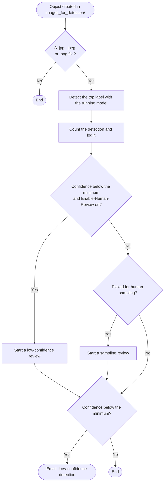

# 4. Detection

Every image that you add to `images_for_detection/` starts the detection workflow. It asks the running model for the image's top label and logs the result in the inference log, a DynamoDB table. Detection needs a running model, so finish [section 3](../3-Model-Training/) first.

## Check one image

Start with an image that the model was trained on. It should get a high confidence.

```bash
aws s3 cp sample-images/amazon_logo/amazon-1.png "s3://$BUCKET/images_for_detection/"
sleep 15
RUN=$(aws stepfunctions list-executions --state-machine-arn "$DETECTION" --max-results 1 \
  --query "executions[0].executionArn" --output text)
aws stepfunctions describe-execution --execution-arn "$RUN" --query output --output text
```

The output shows the label, the confidence, and the result's ID in the inference log:

```json
{"id":"...","image":"s3://.../images_for_detection/amazon-1.png","label":"amazon_logo","confidence":99.2,"minimumConfidence":70,"belowMinimumConfidence":false,"detectionNumber":1,"sampled":false,"review":null}
```

## Check the sample's inference images

The inference images include Whole Foods Market logos and other Amazon and AWS images that the model hasn't seen, so some of them get a low confidence.

```bash
aws s3 cp sample-images/inference_images/ "s3://$BUCKET/images_for_detection/" --recursive --exclude ".*"
```

For each image below `Minimum-Label-Detection-Confidence` (70%), you get a **Low-confidence detection** email, and the detection becomes a review task for [section 5](../5-Human-Review/). Passing detections don't send email.

## Read the inference log

```bash
aws dynamodb scan --table-name "$LOG_TABLE" \
  --query "Items[].[S3ObjectKey.S, DetectedLabel.S, DetectedConfidenceLevel.N, BelowMinimumConfidence.BOOL]" \
  --output text
```

Each detection writes one item:

| Attribute | Contents |
|---|---|
| `DetectLabelRequestId` | The item's ID, which is also the detection run's name |
| `DetectLabelDate` | When the image was uploaded |
| `S3Bucket`, `S3ObjectKey`, `S3ObjectEtag` | The image |
| `ProjectVersionArn` | The model that labeled it |
| `DetectedLabel`, `DetectedConfidenceLevel` | The top label and its confidence, from 0 to 100 |
| `MinimumConfidenceLevel`, `BelowMinimumConfidence` | The minimum when the image was checked, and whether the confidence was below it |
| `DetectionNumber` | The detection's number, which human sampling uses ([section 6](../6-Human-Sampling/)) |
| `HumanSampled` | Whether the detection was picked for human sampling |

When a detection gets a human review, the review adds more attributes to the same item. Section 5 lists them.

To analyze the log, you can export the table to S3 and query it with Amazon Athena, or build a dashboard with Amazon Quick Sight.

## What the detection workflow does



- Only `.jpg`, `.jpeg`, and `.png` files are checked. The workflow skips other files.
- The workflow uses the running model saved by the training workflow. If no model has been trained yet, or the running model was stopped, the run fails and emails **Detection failed** with the error. Start the model again ([section 7](../7-Conclusions-Cleanup/)) or train one.
- A detection gets at most one review. If it's both low confidence and picked for sampling, it gets a low-confidence review, and its image can be added to the training images.
- Uploading many images at once is fine. Rekognition allows up to 50 detection requests per second for each account, and the workflow retries throttled requests.

Next: [Human review](../5-Human-Review/)
