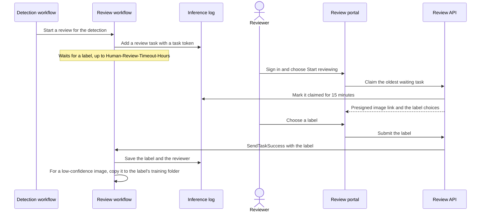

# 5. Human review

A detection below `Minimum-Label-Detection-Confidence` becomes a review task. Reviewers label the image in the review portal. When a reviewer chooses a label, the workflow copies the image into that label's training folder, so the next model learns from it.

## Sign in to the review portal

1. Open the portal's address. It's in your invitation email, and in the `PORTAL` variable from [section 1](../1-Deployment/README.md#set-the-variables-for-the-next-sections):

   ```bash
   echo "$PORTAL"
   ```

2. Choose **Sign in**. Your user name is your notification email address. Use the temporary password from the invitation, which expires 7 days after the deployment.
3. Choose a new password. It needs at least 12 characters.

If the temporary password expired, send a new invitation:

```bash
aws cognito-idp admin-create-user --user-pool-id "$USER_POOL" --username you@example.com \
  --message-action RESEND --desired-delivery-mediums EMAIL
```

## Review images

1. Choose **Start reviewing**. The portal shows the oldest waiting image and a button for each label in `Human-Review-Labels`, plus **None of the above**.
2. Choose the label that fits. The portal saves it and shows the next image.
3. When no images are waiting, the portal says so. Choose **Check again** later.

Some details:

- The portal doesn't show the model's label or confidence, so they don't influence you.
- An image you're labeling is yours for 15 minutes. After that, another reviewer can take it. If you leave the page and come back, you get the same image back.
- **Give this image back** returns the image to the queue for another reviewer.
- Choose **None of the above** when no label fits. The sample's inference images include Whole Foods Market logos, and the default labels are `amazon_logo` and `aws_logo`, so those images are **None of the above**.

## What happens to a label

| Review reason | Label | Result |
|---|---|---|
| Low-confidence detection | One of the labels | The label is saved in the inference log, and the image is copied to `images_labeled_by_folder/<label>/`. |
| Low-confidence detection | None of the above | The answer is saved. The image isn't added to the training images. |
| Human sampling ([section 6](../6-Human-Sampling/)) | Any | The answer is saved, next to the model's label. The image isn't added to the training images. |

The copy's name is the original file name plus the first 8 characters of the image's ETag, for example `inference-image-6-80ac687a.png`. That way, two different images with the same name don't overwrite each other.

After you label some low-confidence images, check the new training images:

```bash
aws s3 ls "s3://$BUCKET/images_labeled_by_folder/" --recursive
```

They count toward `Minimum-Untrained-Images`, so once 10 have been added, the next scheduled check trains a new model ([section 3](../3-Model-Training/README.md#when-the-next-model-is-trained)).

## Review tasks that nobody labels

A review task waits for `Human-Review-Timeout-Hours`, 72 by default. If nobody labels it in time, it expires. You get a **Review task expired** email, and the review run ends as failed, with the error `ReviewExpired`. The image isn't added to the training images.

To see the waiting tasks:

```bash
aws dynamodb query --table-name "$LOG_TABLE" --index-name ReviewQueue \
  --key-condition-expression "ReviewQueue = :pending" \
  --expression-attribute-values '{":pending": {"S": "pending"}}' \
  --query "Items[].[DetectLabelRequestId.S, ReviewStatus.S]" --output text
```

## Add and remove reviewers

The first reviewer is the notification email address. To add another reviewer, create the user and add them to the `reviewers` group. Cognito emails them an invitation with a temporary password.

```bash
aws cognito-idp admin-create-user --user-pool-id "$USER_POOL" --username reviewer@example.com \
  --user-attributes Name=email,Value=reviewer@example.com Name=email_verified,Value=true \
  --desired-delivery-mediums EMAIL
aws cognito-idp admin-add-user-to-group --user-pool-id "$USER_POOL" \
  --username reviewer@example.com --group-name reviewers
```

To stop someone from reviewing, remove them from the group or delete the user:

```bash
aws cognito-idp admin-remove-user-from-group --user-pool-id "$USER_POOL" \
  --username reviewer@example.com --group-name reviewers
aws cognito-idp admin-delete-user --user-pool-id "$USER_POOL" --username reviewer@example.com
```

A user who isn't in the `reviewers` group can sign in, but the portal tells them they can't review. People can't create their own accounts.

## How a review works



The review workflow keeps a review task as attributes on the detection's item in the inference log:

| Attribute | Contents |
|---|---|
| `ReviewStatus` | `OPEN`, `CLAIMED`, `SUBMITTED`, `COMPLETED`, `EXPIRED`, or `FAILED` |
| `ReviewSource` | `LowConfidence` or `HumanSampling` |
| `ReviewCreated`, `ReviewExpires` | When the task was created, and when it expires |
| `ReviewQueue`, `ReviewTaskToken` | Only while the task waits: the key of the `ReviewQueue` index, and the token that sends the label back to the review workflow |
| `ReviewClaimedBy`, `ReviewClaimedByName`, `ReviewClaimExpires` | The reviewer who holds the task, and until when |
| `HumanLabel`, `HumanLabelMatchesModel` | The reviewer's answer, and whether it's the same as the model's label |
| `ReviewedBy`, `ReviewedByName`, `ReviewCompleted` | Who labeled the image, and when |
| `TrainingImageKey` | Where the image was copied, for a low-confidence review |
| `ReviewClosed` | When the task expired or failed |

Next: [Human sampling](../6-Human-Sampling/)
