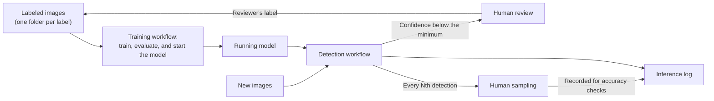
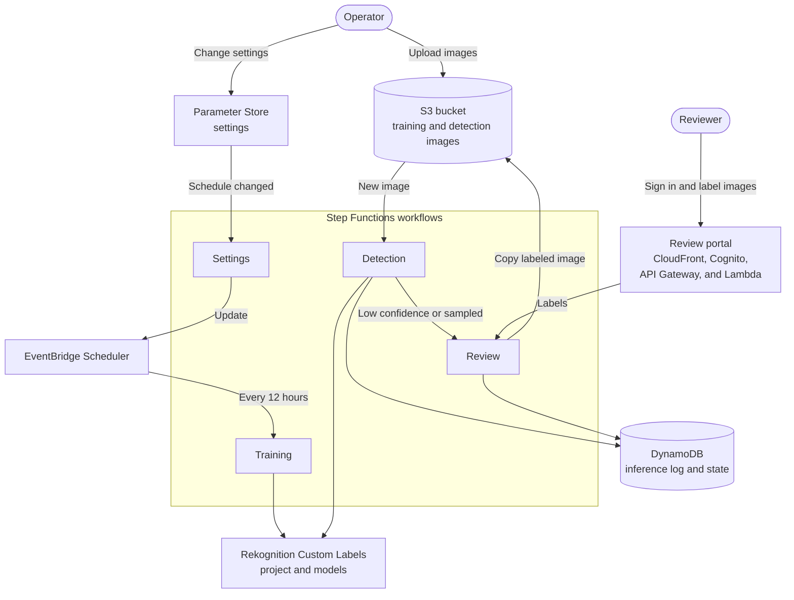

# Automate continuous model improvement with Amazon Rekognition Custom Labels and human review

This sample builds an image classification workflow that improves its model as it's used, without machine learning expertise. It trains an [Amazon Rekognition Custom Labels](https://aws.amazon.com/rekognition/custom-labels-features/) model from labeled images, runs detection on new images, and sends the detections that the model isn't sure about to people for review. Reviewed images become new training data, and the workflow retrains and replaces the model when enough new images are available.

[AWS Step Functions](https://aws.amazon.com/step-functions/) runs every step with direct service integrations. The settings live in [AWS Systems Manager Parameter Store](https://docs.aws.amazon.com/systems-manager/latest/userguide/systems-manager-parameter-store.html), so an operator can change the workflow's behavior without changing code. Reviewers use a small review portal that the stack deploys.

> **Earlier version.** The first version of this sample used Amazon Augmented AI (Amazon A2I) and Amazon SageMaker AI Ground Truth for human review, and a CloudFormation template. Both services stopped accepting new customers on July 30, 2026. This version replaces them with its own review portal and deploys with the AWS CDK. The A2I version is still available at the [`v1-a2i` tag](https://github.com/aws-samples/amazon-rekognition-custom-labels-a2i-automated-continuous-model-improvement/tree/v1-a2i). A stack deployed from that version can't be upgraded in place. Delete it, and then deploy this version as a new stack.

## How it works

The workflow is a loop. Labeled images train a model, the model labels new images, and people label the images that the model was unsure about, which adds training data for the next model.

- **Training.** You add labeled images to S3, one folder per label. On a schedule, the training workflow checks whether enough new images were added. If so, it rebuilds the Custom Labels datasets from the folders, trains a model, and starts the model if its F1 score is high enough. Then it stops the model that the new one replaces.
- **Detection.** When an image is added to the detection folder, the detection workflow asks the running model for the image's top label, logs the result in Amazon DynamoDB, and emails you if the confidence is below the minimum.
- **Human review.** A low-confidence detection becomes a review task. A reviewer signs in to the review portal and chooses the right label. The workflow copies the image into that label's training folder, so the next model learns from it.
- **Human sampling.** Every Nth detection, 1,000 by default, also goes to review, whatever its confidence. These labels are recorded next to the model's label, so you can measure the model's accuracy. Sampled images aren't added to the training data.

## Architecture

The diagram leaves out two things: every workflow emails the operator through Amazon SNS, and a fifth workflow stops the running models when you delete the stack. EventBridge rules connect the S3 bucket and Parameter Store to the workflows.

The stack has five state machines:

- **Training** checks for enough new images, builds a manifest from the label folders, rebuilds the training and test datasets, trains a model, and checks its F1 score. If the score is high enough, it starts the new model and stops the old one. EventBridge Scheduler starts it every 12 hours by default, and you can also start it yourself.
- **Detection** runs for each image added to `images_for_detection/`. It detects the top label, logs the result, starts a review for a low-confidence or sampled detection, and emails low-confidence detections.
- **Review** adds a review task to the detection's log item and waits for a reviewer's label, for up to 72 hours by default. When the label arrives, it saves it, and for a low-confidence image it copies the image into the label's training folder.
- **Settings** applies changes to the two training schedule settings to the EventBridge Scheduler schedule.
- **Cleanup** stops the project's running models when you delete the stack.

The review portal is a page in a private S3 bucket, served through Amazon CloudFront. Reviewers sign in with Amazon Cognito. CloudFront sends the page's `/api/*` requests to an Amazon API Gateway HTTP API, which checks the reviewer's sign-in token and calls the review API, the sample's only Lambda function. The function claims tasks for reviewers and sends their labels to the waiting review workflow.

## Costs

The running model is the main cost. Rekognition Custom Labels charges [$4 per inference hour](https://aws.amazon.com/rekognition/pricing/) for each inference unit while a model runs, whether or not it processes images. With one inference unit, that's about $96 a day. Training costs $1 per training hour, and a model trained on the sample images takes about 10 minutes of billed training.

Stop the model when you're not using it. Section 7 shows how. The other services are billed per use and cost little at sample scale: Step Functions, DynamoDB on-demand tables, Lambda, API Gateway, CloudFront, S3, SNS, EventBridge Scheduler, and Amazon Cognito (free for the first 10,000 monthly active users on the Essentials plan).

## Walkthrough

1. [Prerequisites](./0-Prerequisites/)
2. [Deployment](./1-Deployment/)
3. [Settings](./2-Parameter-Store/)
4. [Model training](./3-Model-Training/)
5. [Detection](./4-Custom-Labels-Detection/)
6. [Human review](./5-Human-Review/)
7. [Human sampling](./6-Human-Sampling/)
8. [Cleanup](./7-Conclusions-Cleanup/)

## Security

- Only users that an administrator adds can sign in, and only members of the `reviewers` group can review. API Gateway rejects API requests without a valid sign-in token before the function runs.
- Images stay in private buckets. The review page gets a presigned link for each image, which expires after 5 minutes. Reviewers don't see the model's label or confidence.
- The review page uses no third-party code. CloudFront adds a strict Content-Security-Policy and other security headers.
- Each workflow and the function have their own IAM role with only the permissions they need.
- The stack doesn't include AWS WAF. To add it, attach a web ACL to the CloudFront distribution (created in us-east-1) and to the Cognito user pool.

This is a sample. Review the code and the settings against your own security and compliance requirements before you use it in production. See [CONTRIBUTING](CONTRIBUTING.md#security-issue-notifications) for how to report a security issue.

## Repository layout

| Path | Contents |
|---|---|
| `app.py`, `cdk.json`, `requirements.txt`, `package.json` | The CDK app, its pinned Python packages, and the pinned CDK CLI |
| `model_improvement/stack.py` | The stack: storage, settings, workflows, triggers, and permissions |
| `model_improvement/statemachines/` | The five state machine definitions, in Amazon States Language with JSONata |
| `model_improvement/review_api/` | The review API function |
| `model_improvement/portal.py`, `model_improvement/portal_page/` | The review portal and its page |
| `sample-images/` | Training images for two labels, and images for detection |

## License

The documentation is available under the Creative Commons Attribution-ShareAlike 4.0 International License. See the [LICENSE](LICENSE) file. The sample code is available under the MIT-0 license. See the [LICENSE-SAMPLECODE](LICENSE-SAMPLECODE) file.

Next: [Prerequisites](./0-Prerequisites/)
