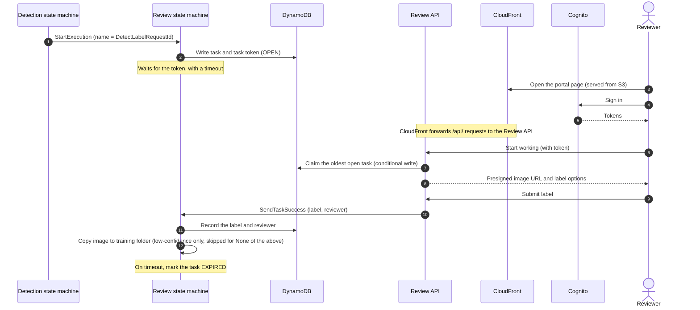

# Redesign tracker

This file tracks the work to bring the sample up to date. The work started with a currency review on November 4, 2026. The repository was last changed in `db61b19` on July 20, 2022, and the line numbers in this file refer to that commit.

## Status

| Workstream | Status |
|---|---|
| Currency review | Done, November 4, 2026 |
| D1: How to handle A2I | Decided November 4, 2026: option B, replace A2I and Ground Truth |
| D2: Deployment tooling | Decided November 4, 2026: AWS CDK in Python, deployed from the reader's computer. AWS CloudShell isn't supported. |
| D3: Review providers | Decided November 4, 2026: custom review portal only. A2I and Ground Truth are dropped completely. |
| D4: Step Functions only | Decided November 4, 2026: workflows use direct service integrations, and the review portal API is the only Lambda function the sample owns |
| D5: State machine layout | Decided November 4, 2026: one state machine per job |
| D6: Human sampling | Decided November 4, 2026: a counter picks every Nth detection as it's logged |
| D7: Training data | Decided November 4, 2026: rebuild the Custom Labels datasets from the S3 folders before each training run |
| D8: Run-time state | Decided November 4, 2026: fixed values go into the state machine definitions, and changing values go into a DynamoDB state item (O10) |
| D9: Failed training runs | Decided November 4, 2026: the next automatic run waits for new images |
| D10: Email notifications | Decided November 4, 2026: milestones and problems only |
| D11: Automated tests | Decided November 4, 2026: none. Each phase is tested by deploying it. |
| D12: AWS WAF | Decided November 5, 2026: not built. The docs can explain how to add it. |
| Human review design | Approved November 4, 2026 |
| Trial T1 | Done November 4, 2026. All seven checks passed, and the trial resources are deleted. |
| Build (H0 to H4) | H0 done November 4, 2026. H1 to H4 done and squash-merged into the local `v2` branch November 5, 2026, and `v2` merged into the local `main` branch. Nothing is pushed. |
| Optional modernization | O1 and O4 adopted for H1, November 4, 2026. The other open items aren't decided. |

## Why the sample needs a redesign

- Amazon A2I and Amazon SageMaker Ground Truth are in maintenance, not shut down. New customers can't use them from July 30, 2026. Existing customers can keep using them, and AWS keeps operating and supporting them but plans no new features. As of the September 29, 2026 availability update, AWS hasn't announced an end-of-support date for either.
- During stack creation, the template creates A2I resources and, with the default parameters, a Ground Truth work team. In an account that doesn't already use A2I, the stack will probably fail to deploy. This conclusion comes from the announcements and hasn't been tested.
- Amazon Mechanical Turk closed on September 30, 2026. The README still offers it as a workforce option.
- Rekognition Custom Labels has no announced availability change. It's offered in the same 11 Regions, and the APIs the sample calls haven't changed.
- All 11 Lambda functions use `python3.9`, which is deprecated.
- The docs have outdated service names, links, console steps, and screenshots. They also contradict each other in places.

## Decisions

### D1: How to handle the A2I dependency

Status: decided November 4, 2026.

Decision: option B, replace A2I and Ground Truth. The workflow needs a human in the loop to stay automated, and new customers can't use A2I or Ground Truth.

| Option | Changes | Effort | Who can run it afterward |
|---|---|---|---|
| A. Keep A2I, make it optional | Add a template condition so the stack deploys without A2I, Ground Truth, and Cognito. Add a notice to the README and 0-Prerequisites. | Small to medium | Anyone can run training and detection. Human review works only in accounts that already use A2I. |
| **B. Replace A2I and Ground Truth (chosen)** | Build a review step that the sample owns. See [Human review design](#human-review-design). | Large | Anyone |
| C. Archive | Add a deprecation notice that links to the AWS maintenance announcement. | Minimal | No new users |

### D2: Deployment tooling

Status: decided November 4, 2026.

Decision: P4, AWS CDK in Python. The redesign adds a web page, Cognito, an HTTP API, and more state machines, and a hand-written template gets hard to maintain at that size. CDK keeps the code, the page, and the state machine definitions in normal files, builds least-privilege IAM permissions from grants, and fixes several baseline defects by construction. Python matches the Lambda code.

| Option | For users | For maintainers |
|---|---|---|
| P1. Inline code only. Delete `lambda/` and `assets/task_ui.html`. | One template, deployed from the console | The code lives in YAML, with no linting or tests. |
| P2. Source files in `lambda/` and `ui/`, embedded into the one template by a small build script | One template, deployed from the console | Real files that can be linted and tested. Run the script after each edit. |
| P3. AWS SAM | Users need the SAM CLI (`sam build`, `sam deploy`). | Standard project layout that stays close to CloudFormation |
| **P4. AWS CDK in Python (chosen)** | Users run a few commands on their own computer, which needs Python, Node.js, the AWS CLI, and Git. AWS CloudShell isn't supported (see below). Each account and Region needs a one-time `cdk bootstrap`. | The code and the review page are normal files. IAM permissions come from grants, and resource names are generated. |

What changes with CDK:

- CDK still deploys through CloudFormation, so stacks, stack events, and deletion policies work as they do today.
- The console-only deployment goes away. A one-click template would need public asset buckets in every Region, which doesn't fit an aws-samples repository.
- CDK requires Node.js 22 or later, even for Python projects.
- AWS CloudShell isn't supported (decided November 4, 2026). Its `python3` is 3.9, which Amazon Linux 2023 keeps for its whole life, and `aws-cdk-lib` 2.275.0 needs Python 3.10 or later. Python 3.10 reached end of life in October 2026, so the docs should ask for Python 3.11 or later.
- `cdk bootstrap` creates a `CDKToolkit` stack with an S3 bucket, an ECR repository, and IAM roles. Some organizations restrict or customize bootstrapping.
- Several baseline items get fixed by construction: generated names (F7), the partition and least-privilege grants (O8), S3 notification permissions and ordering (F6), and custom resource responses (F5).
- The `aws-cdk-lib` and CDK CLI versions need periodic updates.

### D3: Review providers

Status: decided November 4, 2026.

Decision: custom review portal only. A2I and Ground Truth are removed completely, and there's no A2I adapter. The reasons:

- Most readers can't use A2I or Ground Truth. New customers are blocked, and AWS hasn't said how it decides who counts as an existing customer, so even a new account at a company that uses A2I might not qualify.
- Neither service gets new features. Mechanical Turk was on the same June 30 maintenance list and closed on September 30, 2026, three months later.
- A second review path would double the review code, docs, and testing, and the A2I path could only be tested in an account that already uses A2I.
- A2I charges for each reviewed object, even when your own employees do the reviews. The portal has no per-review charge.

What the sample gives up: AWS's managed reviewer portal, vendor workforces from AWS Marketplace, and more than one reviewer per task. The sample used only the managed portal, and it now owns its portal code and that code's security.

Readers who need the A2I version can use the `v1-a2i` tag (H0), which the new README links to (H4).

### D4: Step Functions only

Status: decided November 4, 2026.

Decision: the workflows call AWS services directly through Step Functions service integrations instead of through Lambda functions. The only Lambda function the sample owns is the review portal API. If a step can't be written cleanly as states, it gets a small function instead of a workaround.

Why:

- Step Functions AWS SDK integrations can call almost any AWS API. They cover every operation the sample uses in Rekognition, S3, DynamoDB, Systems Manager, EventBridge, and Step Functions. The only S3 operation listed as unsupported, `SelectObjectContent`, isn't used.
- JSONata and variables handle the data shaping that the Python code does today: string building, arithmetic, dates, filtering, and parsing JSON strings.
- The workflow logic has no runtime to upgrade. Runtime deprecation is what made the current sample stale.
- Every step's input and output shows in the Step Functions console, and retries need no code.

| Current function | Replacement |
|---|---|
| `s3-event-trigger` | S3 EventBridge notifications, plus a rule with a key-prefix filter that starts the detection state machine |
| `rekognition-detect-label` | `rekognition:detectCustomLabels`, a Choice state, `dynamodb:putItem`, and `sns:publish` |
| `check-auto-training` | An `s3:listObjectsV2` loop that counts the images, `rekognition:describeProjectVersions`, and a Choice state |
| `create-training-manifest` | A Distributed Map that writes JSON Lines with `ResultWriter` (D7) |
| `train-deploy-model` | `rekognition:createProjectVersion`, wait loops on `describeProjectVersions`, `startProjectVersion`, and a Map with `stopProjectVersion` |
| `update-event-rules` | `ssm:getParameter`, a Choice state, and `eventbridge:putRule`, `enableRule`, or `disableRule` |
| `create_human_sampling` | A DynamoDB counter in the detection state machine (D6) |
| `a2i_create_humanloop` and `a2i-human-loop` | The review state machine |
| `stage-rekognition-assets` | CDK resources: `CfnProject`, a bucket with EventBridge turned on, CDK's built-in custom resource for the folder placeholders, and the cleanup workflow |
| `stage-a2i-assets` | Removed with A2I |

What still needs Lambda:

- The review portal API. Presigned image URLs have to be generated by code. HTTP APIs can start, start synchronously, and stop executions, but they can't call `SendTaskSuccess`.
- Stopping running models when the stack is deleted. CloudFormation custom resources can't target a state machine. CDK's built-in custom resource function starts a short Express cleanup workflow, so the sample doesn't own that code. The project and trained models are retained, like the bucket and the table, and section 7 explains how to delete them.

Costs accepted:

- The logic lives in JSONata expressions inside the definitions. The manifest build is the densest part.
- Each state's input and output is limited to 256 KiB. S3 listings are paged small or handled by a Distributed Map.
- Step Functions Local is unsupported, so the state machines can't run offline. The sample has no automated tests (D11), and changes are tested by deploying them.
- Step Functions can't generate IAM policies for SDK integrations, so each call needs an explicit permission.

### D5: State machine layout

Status: decided November 4, 2026.

Decision: one Standard state machine per job: detection, training, settings, and review. The Express cleanup workflow from D4 is separate. Each EventBridge rule or schedule targets its own state machine.

Why:

- Small definitions are easier to read now that the logic lives in them.
- It removes the routing Choice state and its matching on `$.resources[0]` ARN patterns, which also hardcode the `aws` partition.
- Each state machine gets its own IAM role.
- Standard keeps every execution visible in the console for the walkthrough. At sample scale, the cost difference from Express doesn't matter. At high volume, detection could move to Express, which is cheaper but is at-least-once and keeps its history in CloudWatch Logs.

### D6: Human sampling

Status: decided November 4, 2026.

Decision: the detection state machine increments a counter in DynamoDB (`UpdateItem` with `ADD` on `DetectionCount` in the D8 state item) for each detection and sends every Nth detection (`Human-Sampling-Interval`) to review right away.

Why:

- It picks exactly every Nth detection.
- There's no sampling schedule and no query loop over a date index, so the pagination and date-format problems (F2) go away.
- It removes the `Automatic-Human-Sampling-Frequency` parameter, the sampling schedule rule, and the `Sampled_GSI` index. `Enable-Automatic-Human-Sampling` and `Human-Sampling-Interval` stay.

Notes:

- This changes documented behavior. Sampling happens as detections arrive instead of on a schedule, and H4 rewrites section 6.
- If a sampled detection is already in a low-confidence review, the review execution name (the detection request ID) prevents a second review.
- One counter item is fine at sample scale. A very high detection rate would make it a hot key.

### D7: Training data

Status: decided November 4, 2026.

Decision: the training state machine rebuilds the project's datasets from the S3 folders at the start of each run:

1. Build the manifest from `images_labeled_by_folder/` with a Distributed Map.
2. Delete the old training and test datasets.
3. Create the training dataset from the manifest (`CreateDataset`).
4. Create an empty test dataset, then move 20% of the images into it (`DistributeDatasetEntries`).
5. Train the model (`CreateProjectVersion`), which uses the project's datasets.

The dataset steps finish in the background, so the state machine waits until each one is complete before moving on.

Why:

- It keeps the designed behavior. The S3 folders stay the source of truth, every run trains on the existing images plus the newly added ones, and the 80/20 split is redrawn each run. Deleting a file, or moving it to another label folder, changes the next model, as it does today.
- The project uses datasets, which AWS recommends, so opening it in the Custom Labels console no longer breaks training (R2).

Rejected alternative: add new images to long-lived datasets with `UpdateDatasetEntries`. That API can add or update entries but not delete them, so deletes and moves in S3 wouldn't carry over. The test split would also have been fixed instead of redrawn each run.

Constraints the workflow has to respect:

- Through the API, training needs both a training dataset and a test dataset. Only the console splits a dataset automatically.
- The test dataset can't share images with the training dataset, and it has to contain at least half of the training labels.
- A dataset can't be deleted while it's being created or updated.
- Edits made to the datasets in the console are replaced on the next run, and the docs have to say so.

### D8: Run-time state

Status: decided November 4, 2026. This was O10.

Decision: replace the `For-System-Use-Only` parameter. CDK writes the fixed values into the state machine definitions at deploy time, the keys the redesign no longer needs are dropped, and the values that change at run time move to one item in a small DynamoDB state table.

| Current key | New home |
|---|---|
| `s3_bucket`, `rekognition_project_arn`, `sns-topic`, `dynamodb_table`, `events_scheduled_rule` | Written into the state machines that use them at deploy time |
| `sampling_scheduled_rule`, `dynamodb_table_GSI` | Removed (D6) |
| `state_machine_arn` | Removed (D4, D5) |
| `a2i_workflow`, `flow_definition_arn` | Removed (D3). No code reads `a2i_workflow` today. |
| `rekognition_project_version_arn` | `RunningModelArn` in the state item |
| `previous_trained_images` | `TrainedImageCount` in the state item |
| (new) | `LastRunImageCount` in the state item, the image count of the most recent training run, whether or not it succeeded (D9) |
| (new) | `DetectionCount` in the state item, the D6 sampling counter |

The state item, shown as plain JSON:

```json
{
  "StateId": "current",
  "RunningModelArn": "arn:aws:rekognition:us-east-1:111122223333:project/logo-project/version/20261104120000/1730721600000",
  "TrainedImageCount": 20,
  "LastRunImageCount": 20,
  "DetectionCount": 1532
}
```

Why:

- Today the stack owns the parameter, but the functions overwrite it, so CloudFormation reports drift. A stack update that changes the parameter's value in the template resets it, which drops the running model's ARN (detection then fails) and sets the trained image count back to 0 (the next check starts an unneeded training run).
- The training function writes back the whole JSON it read when its run started, often an hour earlier, so changes made in between are lost.
- Almost every function starts by reading and parsing the parameter to learn names that were fixed at deploy time.
- Operators see a parameter they mustn't touch, and section 2 has to warn them about it.

Notes:

- Each write changes only its own attribute, so training can't overwrite the counter, and detection can't overwrite training's values.
- The stack owns the table but not the item, so the values don't drift and stack updates don't reset them.
- If the item doesn't exist yet, the state machines treat it as no model running and zero trained images.
- Dataset ARNs aren't stored. D7 recreates the datasets every run, so the training state machine looks them up from the project.
- The state table is separate from the inference log, so the log stays clean for analytics and each state machine's permissions stay narrow.
- The operator settings stay in Parameter Store. H4 removes `For-System-Use-Only` from section 2.

### D9: Failed training runs

Status: decided November 4, 2026.

Decision: after a failed training run, the next automatic run waits until `Minimum-Untrained-Images` more images have been added. A run fails when the model's F1 score is below `Minimum-F1-Score`, or when dataset creation, training, or model start fails. An operator can still start a run by hand.

How it works: when the training state machine decides to train, it saves the image count in the state item as `LastRunImageCount` (D8). Scheduled checks count new images against that value. `TrainedImageCount` still records the images behind the running model.

Rejected:
- Retry at every scheduled check, which is today's behavior. The same images are retrained every 12 hours until a run passes, and each retry costs training time.
- Turn off automatic training after a failure, until an operator turns it back on.

### D10: Email notifications

Status: decided November 4, 2026.

Decision: email only milestones and problems:
- Training started, with the image counts and the model version name
- Training finished, with the F1 score
- New model running, and which models were stopped
- Low-confidence detections
- Settings applied to the training schedule
- Any workflow failure, with the error and a link to the run

A training run that ends below `Minimum-F1-Score` is reported as a workflow failure, with the F1 score in the email.

Today the stack sends email for every detection, every scheduled check (even when nothing happens), every 5-minute status poll during training and model start, every new manifest, and every settings change.

Rejected: keeping every email as today, and failures only.

Note: section 4's walkthrough shows passing detections in the inference log and the Step Functions console instead of email (H4).

### D11: Automated tests

Status: decided November 4, 2026.

Decision: the repository has no automated tests. Each phase is tested by deploying it to the test account and running the walkthrough.

Rejected: template tests (pytest checks on the template CDK generates), and template tests plus workflow tests with the Step Functions TestState API and mocked AWS responses.

## Human review design

Status: approved November 4, 2026.

The sample keeps Step Functions as the orchestrator. The two SageMaker features are replaced by parts that the stack deploys itself:

- A2I human loops become executions of a new review state machine. Each execution writes a review task and a Step Functions task token to DynamoDB, then waits for the token (`.waitForTaskToken`).
- The Ground Truth private workforce and worker portal become a Cognito user pool and a small review portal. The portal's page is one HTML file in a private S3 bucket, served through CloudFront. CloudFront forwards `/api/*` requests to an API Gateway HTTP API with a Cognito JWT authorizer, and one Lambda function handles those API calls.

All of the new parts are serverless and billed per use. None of them depend on SageMaker. The running Custom Labels model is still the main cost.

### What replaces what

| A2I or Ground Truth | Replacement |
|---|---|
| Private workforce and work team | A Cognito user pool with a `reviewers` group. The stack always creates the pool, and the one-workforce-per-Region limit no longer applies. |
| Worker portal (`*.labeling.<region>.sagemaker.aws`) | A review portal at the CloudFront distribution's URL, published as the stack output `ReviewPortalUrl`. Reviewers sign in on Cognito's hosted sign-in pages (managed login). |
| Human task UI (the `crowd-image-classifier` template) | One HTML page, served from S3 through CloudFront, that shows the image and a choice of labels. The labels come from an SSM parameter. |
| Flow definition | The review state machine, plus SSM parameters for the labels and the timeout |
| `StartHumanLoop` | `StartExecution` on the review state machine. The execution name is the detection request ID, which stops a detection from being reviewed twice. |
| Human loop output in S3, read by a Lambda function on an S3 event | The portal calls `SendTaskSuccess`, which resumes the waiting execution, and the execution applies the label. |
| Task availability lifetime | A timeout on the waiting state. Tasks that time out are marked `EXPIRED`. |
| Worker ID in the output | The reviewer's Cognito user ID and username, recorded with the label |

### How a review works

Two paths start a review. One is a detection whose confidence is below `Minimum-Label-Detection-Confidence` while human review is enabled. The other is human sampling, which picks every Nth detection (D6). Both start the review state machine with the same input, and a `source` field records which path it was (`LowConfidence` or `HumanSampling`).



### Stack changes

These changes are relative to the current template.

New:
- The review state machine, a Standard workflow built from direct service integrations with retries and logging (D4).
- A private S3 bucket for the review page. Only the CloudFront distribution can read it, through origin access control (OAC). At deploy time, CDK uploads the page and a small configuration file with the Cognito and API settings the page needs.
- A CloudFront distribution that serves the page from the bucket and forwards `/api/*` requests to the HTTP API. The page and the API share one domain, so the browser needs no CORS setup. A response headers policy adds the security headers, such as Content-Security-Policy and HSTS.
- An HTTP API with a Cognito JWT authorizer, and one Lambda function that handles only the API routes: claim, submit, and release a task. It's the only Lambda function the sample owns (D4).
- ~~Optional AWS WAF, off by default.~~ Not built (D12). See [Security](#security).
- A Cognito app client (public, authorization code flow with PKCE) whose callback URL is the CloudFront URL, a domain, and a `reviewers` group. The stack always creates the user pool. The first reviewer is the notification email address, as in the current template.
- Review attributes on the existing inference log items, plus a sparse GSI that lists open tasks by creation time.
- SSM parameters: `Enable-Human-Review` (replaces `Enable-A2I-Workflow`), `Human-Review-Labels`, and `Human-Review-Timeout-Hours`.

Changed:
- In the detection state machine, "Create HumanLoop" becomes a `states:startExecution` task. The A2I output branch (`s3-a2i-event`) goes away.
- Human sampling moves into the detection state machine as a counter (D6).
- The review state machine applies the label with `s3:copyObject`, `dynamodb:updateItem`, and `sns:publish`. For a low-confidence review, it still copies the image into `images_labeled_by_folder/<label>/`, because the S3 folders stay the source of truth for training (D7). If the reviewer chose "None of the above", it records that answer in the inference log and doesn't copy the image.
- The inference log attributes named after A2I, such as `HumanLoopName`, are renamed.

Removed:
- `A2IWorkFlowAssets` and its Lambda, `FlowDefinitionRole`, `AWS::SageMaker::Workteam`, the `A2IPrivateTeamName` parameter and condition, and the task UI mapping.
- The `a2i-human-loop-data/` prefix and its S3 notification.
- All `sagemaker:*` permissions.
- The sampling schedule rule, the `Automatic-Human-Sampling-Frequency` parameter, and the `Sampled_GSI` index (D6).
- In the docs: the private workforce checks in 0-Prerequisites and the `delete-workforce` cleanup step.

### Defaults

- One reviewer per task, the same as A2I `TaskCount: 1`.
- Tasks expire after 72 hours (`Human-Review-Timeout-Hours`).
- A claim lasts 15 minutes. If a reviewer walks away, the task becomes available to other reviewers again.
- Reviewers don't see the model's label or confidence. This matches the current task UI and avoids biasing the sampling audits.
- Sampled reviews are recorded but not added to the training data, as in the current design.
- A "None of the above" answer is recorded in the inference log, but the image isn't added to the training data, as in the current design.
- The label options are `Human-Review-Labels` (default `amazon_logo,aws_logo`) plus "None of the above".

### Security

- Every API route requires a valid Cognito token, which API Gateway checks before the function runs. The Lambda function also checks that the caller is in the `reviewers` group.
- Images stay private. The API returns presigned URLs that expire after 5 minutes.
- On submit, the API checks that the caller holds the claim and that the label is in the allowed list.
- The page uses no third-party JavaScript. CloudFront adds a strict Content-Security-Policy and the other security headers.
- The page's bucket is private, and only the CloudFront distribution can read it.
- AWS WAF isn't built (D12, decided November 5, 2026). It was planned as a deploy-time option, off by default. The docs can explain how to add it:
  - A web ACL for the CloudFront distribution has to be created in us-east-1, plus a regional web ACL on the Cognito user pool to cover the sign-in pages.
  - With a basic rule set (AWS managed common rules, an IP reputation list, and a rate limit), each web ACL costs about $8 a month, even when idle.
  - CloudFront's flat-rate plans include WAF in a fixed monthly price, with a $0 tier, but you sign up for them outside CloudFormation.
  - Without WAF, API Gateway still rejects requests that don't carry a valid sign-in token, each API route is limited to 10 requests per second, and only invited users can sign in.
- Amazon Cognito Sync is in maintenance, but user pools, which this design uses, are not.

### Alternatives considered

| Alternative | Why not |
|---|---|
| Email with approval links (the Step Functions human approval pattern) | A plain-text email can't show the image safely. Anyone who has the email can use the links, mail scanners can follow them, and there's no reviewer identity. |
| Rekognition Custom Labels console labeling | Reviewers would need AWS console access. There's no task queue and no completion event to automate on, and it doesn't fit sampling audits. |
| Self-hosted Label Studio or CVAT on ECS Fargate | These tools support bounding boxes and richer labeling workflows, but they add containers, a database, and always-on cost. They suit production use but are too heavy for this sample. |
| An SQS queue for review tasks | SQS works with task tokens, but the portal needs to count, list, and release tasks, which DynamoDB handles better. |
| The Lambda function serving the page through the HTTP API | It needs fewer resources and deploys faster the first time. But every page load runs code, the security headers live in the function's code, and HTTP APIs can't use AWS WAF. |
| Lambda Web Functions (October 2026) | They support only Node.js and are available in 5 Regions, while Custom Labels is in 11. |

### Out of scope for the first version

- Bounding-box labeling. The sample uses image-level labels.
- Multiple reviewers per task and consensus.
- A user-management page. Reviewers are added in the Cognito console or with the AWS CLI.

### Build plan

Each phase ends with a stack that deploys and can be tested. Commits stay local: nothing is pushed to GitHub, and no pull requests are opened, unless the owner says otherwise.

Each phase is built on its own local branch (`v2-h1`, `v2-h2`, and so on), created from a local `v2` branch. After the owner reviews a phase, it's squash-merged into `v2`, so each phase becomes one commit, and the phase branch is deleted (the owner's rule since November 5, 2026). After H4, `v2` is merged into `main`. This tracker is committed on `v2`.

- [x] **H0.** Tag the current commit, `db61b19`, as `v1-a2i` and push the tag, so readers can still find the A2I version. Done November 4, 2026: the annotated tag `v1-a2i` points to `db61b19` and is on GitHub.
- [x] **T1.** Run a trial in a test account (us-west-2) before H1, to prove the parts of D4 and D7 that the docs don't settle. All seven checks passed on November 4, 2026, and the trial resources were deleted the same day. A throwaway CDK app in `spikes/t1/` created two stacks, `T1Core` and `T1Flows`, and used the 10 sample training images. The app wasn't part of the sample and was deleted after the trial. Each check has a pass condition and a fallback:
  1. **Manifest.** A Distributed Map writes the training manifest as JSON Lines, the state machine finds the results file through the map run's `manifest.json`, and `CreateDataset` builds the training dataset from it. Passes if the dataset has all 10 images and both labels. Fallback: build the manifest with a small Lambda function, which D4 allows.
  2. **Test split.** `DistributeDatasetEntries` moves 20% of the images into the test dataset. Passes if the test set includes every label, because Custom Labels needs at least half of the training labels in the test set. Fallback: pick the test images per label in the state machine and create the test dataset from its own manifest.
  3. **Models survive dataset deletion.** Train a model from the datasets and start it, delete both datasets, and run a detection. Then stop the model, start it again, and run another detection. Passes if both detections work. Fallback: revisit D7.
  4. **Dataset timings.** Time the create, distribute, and delete steps during checks 1 to 3. The results set the wait intervals in the training state machine.
  5. **S3 key encoding.** Upload files whose names contain spaces, plus signs, parentheses, and non-ASCII characters, and log the EventBridge events. This shows whether keys arrive URL-encoded. If they do, the state machine decodes them.
  6. **Callback through DynamoDB.** A state saves its task token in a DynamoDB item with `dynamodb:putItem.waitForTaskToken`. Passes if the run pauses and resumes with the `SendTaskSuccess` payload, and if a second run times out into its Catch. Fallback: write the item with a small Lambda function.
  7. **Listing page size.** List about 1,000 objects with realistic names, using `MaxKeys` values of 1,000 and 500. This finds the largest page that stays under 256 KiB, and whether the limit applies before or after the state's `Output` trims the result. Fallback: smaller pages, or count the objects with a Distributed Map.

  Not in T1: the review portal, WAF, the settings and review workflows beyond check 6, the final CDK project layout, the docs, and H0. The expected cost is roughly $5 to $10, mostly Custom Labels training ($1 per training hour) and model hosting ($4 per hour while the model runs). Teardown deletes the model, the project, the bucket, and both stacks.

  Results (November 4, 2026). All seven checks passed, so none of the fallbacks are needed:

  | Check | Result | Details |
  |---|---|---|
  | 1. Manifest | Pass | The Distributed Map wrote `manifests/<map run ID>/SUCCEEDED_0.jsonl` with 10 lines. The folder placeholder objects were skipped by returning an empty array from the child state. The map run's `manifest.json` lists the file under `ResultFiles.SUCCEEDED[0].Key`. `CreateDataset` accepted the file: 10 labeled images, 2 labels, no errors. The S3 item reader reports `LastModified` in epoch seconds, so the child state converts it for `creation-date`. |
  | 2. Test split | Pass | With 2 labels: 8 training and 2 test images, one test image per label. A second run with 3 labels of uneven size (5, 5, and 3 images) gave 10 training and 3 test images, again one per label, so the split follows labels. |
  | 3. Models survive dataset deletion | Pass | Model `t1-v1` trained from the project datasets in about 20 minutes (11 billable minutes) with an F1 score of 1.0. While it was running, the second run deleted both of its datasets and rebuilt them. The model stayed running, kept its evaluation results, and returned the same detection (`amazon_logo`, 93.7%). After a stop and a restart, with its source datasets gone, it started again and detection still worked. |
  | 4. Timings | Measured | Deleting the old datasets, creating the training dataset, and distributing the entries each finished within one 10-second polling interval. Creating the empty test dataset finished within one 5-second interval. The manifest build took 2 to 7 seconds. Starting the model took about 6 minutes both times, and stopping it took about 12 seconds. The training state machine can poll the dataset steps every 10 seconds, the model start every minute, and training every 5 minutes. |
  | 5. S3 key encoding | Pass | EventBridge delivers object keys as-is. Spaces, plus signs, parentheses, and non-ASCII characters arrive unencoded, unlike classic S3 notifications. No decoding step is needed, which also removes today's bug with such file names. |
  | 6. Callback through DynamoDB | Pass | The state machine deployed with `dynamodb:putItem.waitForTaskToken` and stored a 648-character token in the item. `SendTaskSuccess` resumed the run with its payload, and a run with a 20-second timeout went to its Catch. A JSONata expression in `TimeoutSeconds` worked. |
  | 7. Listing page size | Pass, with a limit | `MaxKeys` 1,000 failed with `States.DataLimitExceeded`. `MaxKeys` 500 succeeded with a 140,357-character result, about 280 bytes per object for 87-character keys. The limit applies to the raw SDK result, before `Output` trims it. Use `MaxKeys` 500. |

  Tooling finding: the CDK CLI installed on the test machine (2.1117.0) was too old for the current `aws-cdk-lib` (2.275.0 needs CLI 2.1147.0 or later), so the trial installed the CLI locally in `spikes/t1/`. The test machine's global CLI was updated to 2.1147.0 after the trial. H1 should pin both versions.

  Teardown finding: after the model and both datasets were deleted, `cdk destroy` removed both stacks and everything in them, including the project. It left three CloudWatch log groups, one for each Lambda function that CDK adds for its own custom resources (S3 auto-delete, S3 bucket notifications, and the EventBridge-to-Logs resource policy). Lambda creates these log groups on first run, outside the stack, so they were deleted by hand. The `@aws-cdk/aws-lambda:useCdkManagedLogGroup` flag, which `cdk init` turns on, doesn't fix this: it gives the `AwsCustomResource` function a stack log group that's retained on delete, and the other two functions get none. H1 should pass its cleanup `AwsCustomResource` a log group that's deleted with the stack (the `log_group` property). Section 7 should list the log groups that remain, and the `CDKToolkit` stack and its assets bucket, which `cdk destroy` doesn't remove.
- [x] **H1.** Done November 5, 2026: squash-merged into `v2` as `751b7ac`. Rebuild the stack in CDK (Python) without A2I and Ground Truth: one Step Functions state machine per job (D4, D5), dataset-based training (D7), counter-based sampling (D6), the state table (D8), the Scheduler schedule (O1), on-demand tables (O4), the failed-run rule (D9), and the D10 emails. Apply R2, R3, and the open F items, and remove the old template, the `lambda/` folder, and `assets/task_ui.html` (DOC11). After this phase the stack deploys in any account, and training and detection work. Human review, including sampling, stays off until H2.

  H1 defaults: one stack. `aws-cdk-lib` 2.275.0, `constructs` 10.8.1, and CDK CLI 2.1147.0 are pinned, with the CLI in `package.json` and run through `npx cdk`. The schedule and its parameter share one default, 720 minutes (F8). Only `.jpg`, `.jpeg`, and `.png` files count as images, for training and for detection.

  H1 status, November 4, 2026: the CDK app is on `v2-h1`. It synthesizes, and all four definitions pass `ValidateStateMachineDefinition`. The JSONata in each state was checked with the TestState API and mocked AWS responses. Those checks were one-off and aren't in the repository (D11). Layout: `app.py`, `cdk.json`, `requirements.txt`, and `package.json` at the root, with the stack in `model_improvement/stack.py` and the definitions in `model_improvement/statemachines/`.

  H1 deployment test, November 4, 2026, in the test account (us-west-2). Everything passed:

  | Test | Result |
  |---|---|
  | Deploy | The stack deployed in 132 seconds, with 51 resources. The two S3 folders exist, the schedule is `rate(12 hours)` and enabled, and the bucket sends events to EventBridge. |
  | Empty bucket | A scheduled run ended with "Not enough new images" (0 images). A manual run failed with `NoTrainingImages` and emailed. |
  | First training run | 10 images, plus a `README.txt` that was correctly left out. The manifest, both datasets, and the split took about 45 seconds: 8 training and 2 test images, 2 labels. Training took 15 minutes (546 billable seconds), with an F1 score of 1.0. The model start took 5.5 minutes. The run took 21.5 minutes in all and saved the model, `TrainedImageCount` 10, and `LastRunImageCount` 10. Evaluation results were written to the bucket, so Rekognition can use the workflow role's S3 permissions. No bucket policy for the Rekognition service is needed. |
  | One run at a time | A manual run started during training ended with "Another training run is in progress." |
  | Settings | Invalid values (confidence 150, F1 1.5, frequency 0, `yes`) were rejected by the allowed patterns. Four changes each updated the schedule within 5 seconds: `rate(1 minute)` enabled, then disabled, then `rate(720 minutes)` disabled, then enabled. The target input and retry policy were kept. |
  | Detection | 10 inference images plus a `notes.txt`. The text file was skipped. The 10 images were logged with `DetectionNumber` 1 to 10, and 3 were below 70% and emailed. A detection during the retrain used the old model. |
  | Failed-run rule (D9) | With no new images, a scheduled run ended with "Not enough new images" (10 images, 0 new). |
  | Retrain | 10 more images, labeled by hand. 5 Whole Foods Market logos went into a new `wholefood_logo` folder, which added a third label. A scheduled-style run trained on 20 images and 3 labels (15 training, 5 test) in 16 minutes (672 billable seconds), with an F1 score of 1.0. It started the new model, stopped the old one, and updated the state item. The next detection used the new model. |
  | Cleanup workflow | Run by hand with no models running, it succeeded and stopped nothing. Stopping models on stack delete hasn't been tested, because the stack stays deployed for H2. |
  | Emails | 14 published, 9 delivered, 0 failed. The first 5 were published before the subscription was confirmed. |

  Cost: about $3.70. That's 20 billable training minutes (about $0.34) and about 50 minutes of model hosting (about $3.35), counted from each start request to the stop. Both models are stopped.

  Found and fixed during the test: `S3KeyPrefix` `evaluation/` produced keys like `evaluation//EvaluationResultSummary-....json`, because Rekognition adds its own slash. It's now `evaluation`, redeployed with only the training state machine changed.

  Seen during the test: the schedule started the training workflow 39 seconds after deployment and again right after the settings were restored, outside the 12-hour rate. Scheduler starts a rate schedule soon after it's created or updated. Both runs ended without training ("Not enough new images" and "Another training run is in progress"). The H4 docs should say a check can run right after a deployment or a settings change.

  H1 implementation notes, for review:
  - The default stack name is `CustomLabelsModelImprovement`. Override it with `-c stackName=...`. The notification email is the `NotificationEmail` stack parameter.
  - Settings are under `/<stack name>/` in Parameter Store. Each parameter has an allowed pattern, so Parameter Store rejects invalid values, such as a confidence above 100.
  - The project name is the stack name plus the last segment of the stack ID, because the project is retained when the stack is deleted. Redeploying a stack with the same name creates a new project.
  - The bucket, the inference log, and the project are retained when the stack is deleted. The state table, the log groups, and the parameters are deleted.
  - The bucket sends events to EventBridge through the CloudFormation property. That avoids the Lambda function that CDK's `eventBridgeEnabled` property adds. The only Lambda function is CDK's own custom resource function (D4), and its log group is deleted with the stack.
  - Each workflow emails its own failures with a clear subject, from a shared "Notify failure" step, and then fails (D10). The training workflow reports an F1 score below the minimum this way.
  - Only one training run happens at a time. A run that finds another training run in progress ends without doing anything.
  - Inference log items use the detection run's name as `DetectLabelRequestId`. They also get `DetectionNumber`, the D6 counter value, and `BelowMinimumConfidence`. The A2I attributes are gone.
  - The training workflow polls the datasets every 10 seconds, training every 5 minutes, and model start every minute (T1 check 4). Replaced models are stopped but not deleted.
  - Known limitation: a stack update that changes the training schedule resource resets the schedule to 720 minutes and enabled, even if the parameters say otherwise. Changing either parameter again fixes it. The H4 docs should mention this.
- [x] **H2.** Done November 5, 2026: squash-merged into `v2`. Build the review backend: the review state machine, the DynamoDB attributes and GSI, the SSM parameters, and the portal API function (R1). Turn on human review and sampling, and test them with a script.

  H2 status, November 5, 2026: done. Built on the local `v2-h2` branch, deployed to the test account, and fully tested, including the detection-to-review path with a running model.

  H2 implementation notes, for review:
  - Scope change: the Cognito user pool, the `reviewers` group, and the first reviewer move to H3. Creating the first reviewer sends an invitation email with a temporary password, and there's no sign-in page until H3. The function checks for the `reviewers` group in the token claims, so H2 doesn't need the pool.
  - New settings: `Enable-Human-Review` (true), `Enable-Automatic-Human-Sampling` (true), `Human-Sampling-Interval` (1000), `Human-Review-Labels` (`amazon_logo,aws_logo`), and `Human-Review-Timeout-Hours` (72). There are 11 settings in all. Labels may contain only letters, digits, underscores, and hyphens, because each label is also a folder name. The timeout accepts decimals, and the shortest timeout is 1 minute.
  - The two review switches are independent. A low-confidence detection gets a review when `Enable-Human-Review` is true. A sampled detection gets one when `Enable-Automatic-Human-Sampling` is true. A detection that is both gets one low-confidence review. The inference log records `HumanSampled` for every detection.
  - The review run's name is the detection's inference log ID, so a detection can't get two reviews. The detection workflow treats `ExecutionAlreadyExists` as success.
  - Review attributes on the inference log item: `ReviewStatus` (OPEN, CLAIMED, SUBMITTED, COMPLETED, EXPIRED, or FAILED), `ReviewSource`, `ReviewCreated`, `ReviewExpires`, the claim (`ReviewClaimedBy`, `ReviewClaimedByName`, `ReviewClaimExpires`), and the result (`HumanLabel`, `HumanLabelMatchesModel`, `ReviewedBy`, `ReviewedByName`, `ReviewCompleted`, `TrainingImageKey`). `HumanLabelMatchesModel` supports the sampling audits. `ReviewTaskToken` and `ReviewQueue` are removed when the review ends.
  - The review queue is a sparse index named `ReviewQueue`, keyed on `ReviewQueue` and `ReviewCreated`. Only waiting tasks have the `ReviewQueue` attribute.
  - The review workflow waits with `aws-sdk:dynamodb:updateItem.waitForTaskToken`. It retries only `States.TaskFailed`, so a timeout is never retried.
  - A labeled low-confidence image is copied to `images_labeled_by_folder/<label>/<name>-<first 8 characters of the ETag>.<extension>`. That stops two different images with the same name from overwriting each other. The same image uploaded again under the same name is copied only once. Under a different name, it's copied again.
  - An expired review emails the operator and ends as a failed run (`ReviewExpired`), because the image didn't get its review. A completed review doesn't email (D10). The low-confidence email now says whether a review task was created.
  - The review API function runs on `python3.14` (R1) on arm64, with 256 MB and a 10-second timeout. It has three routes: claim, submit, and release. It never returns the model's label or confidence. It never logs task tokens or presigned URLs. Its only Step Functions permission is `states:SendTaskSuccess` on the review state machine.
  - Claiming: the oldest open task is claimed first, with a conditional write. A reviewer who already holds a task gets the same task back, and the claim is renewed. A claim lasts 15 minutes, after which another reviewer can take the task.
  - Submitting: the claim check and the change to SUBMITTED are one conditional write, so the next claim can't return a task that's being submitted. If `SendTaskSuccess` fails for a reason other than a closed task, the claim is restored, so the reviewer can submit again.
  - Presigned image URLs last 5 minutes. They use the Regional S3 endpoint, so they work right after the bucket is created. The H3 page's Content-Security-Policy has to allow images from `https://<bucket>.s3.<region>.amazonaws.com`.

  H2 test, November 5, 2026, in the test account, without a running model. A throwaway script (not in the repository, D11) started reviews for H1 inference log items and called the function directly, with the claims a JWT authorizer would pass. Everything passed:

  | Test | Result |
  |---|---|
  | Deploy | 17 resource changes in 112 seconds. The new index was added to the existing inference log table. |
  | Review tasks | Three reviews (two low-confidence, one sampled) each wrote an OPEN task with a 668-character task token. |
  | Access | No claims got 401. A user outside the `reviewers` group got 403. An unknown route got 404, and a bad task ID got 400. Groups passed as the HTTP API string (`[reviewers]`) and as a list both worked. |
  | Claiming | Four reviewers claimed the tasks oldest first. A reviewer who already held a task got the same one back, and a fifth reviewer got none, with 0 waiting. The task data had no model label or confidence. |
  | Image URL | The presigned URL returned the image with HTTP 200 and the right size, from the Regional endpoint. A URL with a changed expiry got 403. |
  | Submitting | Another reviewer's task got 409, and an invalid label got 400. A low-confidence `aws_logo` answer was saved and copied to `images_labeled_by_folder/aws_logo/inference-image-6-80ac687a.png`. The next claim didn't return the submitted task, and a second submit got 409. A None of the above answer and a sampled answer were saved and not copied. |
  | Releasing | A release reopened the task for the next reviewer. A second release got 409. |
  | Duplicate review | Starting a review with an existing name failed with `ExecutionAlreadyExists`. |
  | Expiry | With `Human-Review-Timeout-Hours` set to 0.02, the task timed out after 72 seconds. It was marked EXPIRED, taken out of the queue, and emailed, and the run failed with `ReviewExpired`. The timeout was then set back to 72. |
  | Function | 22 calls, 32 ms on average, 450 ms cold start, 105 MB of memory. The logs had no task tokens or presigned URLs. |

  H2 detection test, November 5, 2026, with the newest model running and `Human-Sampling-Interval` set to 2. Everything passed:

  | Test | Result |
  |---|---|
  | Neither low confidence nor sampled | Detections 13 and 15 (80.5%) got no review. |
  | Low confidence and sampled | Detection 14 (61.4%) got one low-confidence review, and the log recorded `HumanSampled`. |
  | Sampled only | Detection 16 (80.5%) got a sampling review. |
  | Low confidence only | With `Minimum-Label-Detection-Confidence` set to 100, detection 17 got a low-confidence review. Its image was named `Logo test (1)+é.png`. |
  | Duplicate review | A detection run whose review name was already used caught `StepFunctions.ExecutionAlreadyExistsException`, logged the detection, and succeeded. |
  | Labeling | Four reviews were labeled through the review API. The two low-confidence images were copied to `amazon_logo/h2-check-2-350f5f88.png` and `aws_logo/Logo test (1)+é-80ac687a.png`, so the encoded copy source works. The two sampled reviews were saved and not copied. |
  | Emails | 3 low-confidence emails, all delivered. |

  The model ran for about 7.5 minutes, from the start request to the stop, which is about $0.50. Both settings were restored, and no reviews are left waiting. The H2 tests left three test copies in the training folders: `aws_logo/inference-image-6-80ac687a.png`, `aws_logo/Logo test (1)+é-80ac687a.png`, and `amazon_logo/h2-check-2-350f5f88.png`.

  Owner decisions, November 5, 2026: the Cognito user pool and `reviewers` group stay in H3, copies keep the ETag suffix, and an expired review emails and fails. Because the tests passed, H2 was squash-merged into `v2` without a separate review, and H3 started right away.
- [x] **H3.** Done November 5, 2026: squash-merged into `v2`. Build the review portal: the Cognito user pool, the `reviewers` group, and the first reviewer (moved from H2), the Cognito app client and domain, the HTTP API and authorizer, the page bucket and CloudFront distribution, and the review page. The optional WAF web ACLs aren't built (D12).

  H3 status, November 5, 2026: done. Built on the local `v2-h3` branch, deployed to the test account, tested by script, and walked through in a browser by the owner. WAF isn't built (D12).

  H3 implementation notes, for review:
  - The portal is a construct in `model_improvement/portal.py`. The page is in `model_improvement/portal_page/`: `index.html`, `app.js`, and `app.css`, with no third-party code.
  - Cognito: the user pool uses the Essentials plan, the default, because managed login needs Essentials or Plus. It's free for the first 10,000 monthly active users, then $0.015 each. Only administrators add users. Reviewers sign in with a user name, which isn't case-sensitive. The first reviewer's user name is the notification email address, as in v1. Passwords need 12 characters or more, and temporary passwords last 7 days. Authenticator-app MFA is optional, and account recovery uses email. The invitation email names the portal URL.
  - The user pool is deleted with the stack, along with its users. The bucket, the inference log, and the project are kept.
  - App client: public (no secret), with the authorization code flow and PKCE, and the `openid`, `email`, and `profile` scopes. The callback and sign-out URLs are the portal URL. It prevents user-existence errors and allows token revocation. Access and ID tokens last 1 hour, and refresh tokens last 12 hours.
  - The Cognito domain is `review-<last segment of the stack ID>`, with managed login and Cognito's default style.
  - HTTP API: the three POST routes use a JWT authorizer (issuer: the user pool, audience: the app client). Each route is limited to 10 requests per second, with bursts of 20. The page sends the access token, which carries `cognito:groups` and `username`.
  - CloudFront serves the page from a private bucket through origin access control, and sends `/api/*` to the HTTP API. Caching is off for both, because the page is small and the API is dynamic. The distribution uses price class 100 (edge locations in North America and Europe). Reviewers elsewhere can still use it, with more latency.
  - Response headers on the page and the API: a Content-Security-Policy that allows scripts and styles from the portal only, images from the images bucket's Regional endpoint, and connections to the Cognito domain, with `frame-ancestors 'none'`, `form-action 'none'`, and `base-uri 'none'`. Also HSTS (1 year), `nosniff`, `X-Frame-Options: DENY`, and `Referrer-Policy: no-referrer`.
  - CDK's built-in custom resource writes the page files with `Cache-Control: no-cache`, so no extra Lambda function is needed, and it deletes them with the stack. `config.json` holds the Region, the app client ID, the Cognito domain, and the portal URL.
  - The page keeps tokens in the tab's session storage, and refreshes the access token when it expires. Sign-out revokes the refresh token and ends the Cognito session. "Give this image back" releases the claim and doesn't claim again, because the next claim would return the same task.
  - Scripted tests: deploying with `-c reviewerTestSignIn=true` adds the admin user-password flow to the app client, so a script with IAM credentials can get tokens without a browser. It's off by default, and the test account was redeployed without it.
  - Known limitation: the HTTP API's own `execute-api` URL is also reachable, not only through CloudFront. It still needs a valid token. WAF added later (D12) would cover CloudFront and the user pool, not that URL.

  H3 test, November 5, 2026, in the test account, by script. Everything passed:

  | Test | Result |
  |---|---|
  | Deploy | 31 new resources in 242 seconds. |
  | Page | The page, `app.js`, `app.css`, and `config.json` were served with all the security headers. A missing file got 403. The managed login page loaded. |
  | Cognito CORS | The token endpoint allows requests from the portal's origin, so the page can exchange the sign-in code. |
  | API access | No token and a bad token got 401 from API Gateway. A signed-in user outside the `reviewers` group got 403. |
  | Review through CloudFront | With real Cognito tokens, a reviewer claimed a task, loaded its image from the host that the CSP allows, released it, claimed it again, and submitted a label. The review recorded the Cognito user name. |
  | First reviewer | Created with the invitation sent, in the `reviewers` group, and waiting to set a password. |
  | Cleanup | The test users were deleted, and the stack was redeployed without the test flow in 13 seconds. |

  Browser walkthrough, November 5, 2026, by the owner. Passed: the owner signed in with the invitation's temporary password, set a new password (the account is now CONFIRMED), and labeled two waiting sampling reviews as None of the above. One was a Whole Foods Market logo and one was an AWS service icon, and neither label is in `Human-Review-Labels`. Both reviews were saved with the reviewer `chanles@amazon.com`, and neither image was copied. The function logged no errors.
- [x] **H4.** Done November 5, 2026: squash-merged into `v2`, and `v2` merged into `main`. Rewrite the README and sections 0, 1, 4, 5, 6, and 7, apply the DOC items, and redraw the diagrams. Section 1 switches from the CloudFormation console to running `cdk deploy` on the reader's computer. It lists the prerequisites and says that CloudShell isn't supported. The README explains that the first version used A2I and links the `v1-a2i` tag.

  H4 decisions, November 5, 2026:
  - The repository isn't renamed. The organization's rules would require a `sample-` prefix for a new name.
  - README title: "Automate continuous model improvement with Amazon Rekognition Custom Labels and human review".
  - The July 2021 blog series isn't mentioned.
  - Mermaid diagrams in the Markdown replace the PNG and draw.io files in `assets/`.
  - The walkthrough uses AWS CLI commands, with short console notes and no screenshots.
  - The eight numbered sections stay. `5-A2I-Human-Loop` becomes `5-Human-Review`.
  - The finished docs are tested on a fresh stack, following them exactly from deployment to cleanup.

  H4 status, November 5, 2026: done. Written on the local `v2-h4` branch and tested on a fresh stack in the test account.

  H4 changes:
  - README: the new title, a note about the first version that links the `v1-a2i` tag and says an old stack can't be upgraded in place, two Mermaid diagrams, costs, security, and the repository layout.
  - Sections 0 to 7 are rewritten for the CDK version, with AWS CLI commands. Section 0 lists the 11 Regions, the running-model quota, and the tools, and says CloudShell isn't supported. Section 5 is now `5-Human-Review`.
  - `CONTRIBUTING.md` links to this repository (DOC13).
  - Removed the v1 diagrams in `assets/`, the screenshots, the v1 state machine definition in `stepfunctions/`, and `sample-images.zip`. Mermaid diagrams in the Markdown replace the diagrams (DOC14).
  - All internal links and anchors, and 30 external links, pass a link check. The five Mermaid diagrams render with mermaid-cli 11.17.1.

  H4 docs test, November 5, 2026, on a new stack named `CustomLabelsDocsTest`, deployed from a clone of `v2-h4`. The commands were run as written, with these differences: a local clone instead of GitHub, `--require-approval never` and `--force` instead of typing `y`, reviews labeled by calling the review API function (the owner checked the portal in H3), the test reviewer created with `--message-action SUPPRESS`, and the invitation `RESEND` not run, because it emails the owner. Everything passed after the fixes below:

  | Section | Result |
  |---|---|
  | 1. Deployment | Deployed in 221 seconds. The variables block set all 9 variables. The first scheduled check ran during the deployment, 40 seconds after the schedule was created, and ended with "Not enough new images to train", without email. The docs said "right after the deployment" (fixed). |
  | 2. Settings | The list showed the 11 defaults. A change worked, and a confidence of 101 and an interval of `1,000` were rejected. The state item doesn't exist until the first training run, so `get-item` printed nothing (docs fixed). |
  | 3. Training | 10 images uploaded. The run took 31.6 minutes: 20.4 minutes of training (672 billable seconds), an F1 score of 1.0, and a 6-minute model start. Three emails: Training started, Training finished, and New model running. The docs said 15 minutes of training and 25 minutes in all (fixed). The model table's first column was `None`, because `DescribeProjectVersions` has no `VersionName` field (fixed). |
  | 4. Detection | One image was detected 2 seconds after its upload, in 1.2 seconds, so `sleep 15` is enough. The output matched the docs. The 10 inference images gave 5 detections below 70%, 5 low-confidence emails, and 5 review tasks. Every log item had the 12 documented attributes. |
  | 5. Human review | The user pool matches the docs: 12-character passwords and 7-day temporary passwords. The queue query showed the 5 tasks. They were claimed oldest first, without the model's label or confidence. Two images were labeled `aws_logo` and `amazon_logo` and copied, one as `aws_logo/inference-image-6-80ac687a.png`, the example name in the docs. Three were None of the above and weren't copied. Adding and removing a reviewer worked. The attribute table was missing `ReviewQueue`, `ReviewTaskToken`, and `ReviewClosed` (fixed). |
  | 6. Human sampling | With an interval of 2, one of the two uploads got a sampling review. Its label matched the model's, and the accuracy scan printed it. The interval was set back to 1000. |
  | 7. Cleanup | The model stopped in under a minute. A detection while it was stopped failed and emailed. It started again in 6 minutes. `cdk destroy` with the model running took 11 minutes 50 seconds, and the cleanup workflow stopped the model. That was the first test of stopping models on delete (F4). The kept resources were deleted with the docs' commands, each on the first try. |

  Found and fixed during the test: the custom resource log group was left over after `cdk destroy`. CloudFormation deleted it, and 3 seconds later Lambda delivered the logs of the function's last Delete calls and created the group again, with the default role's `logs:CreateLogGroup` permission from `AWSLambdaBasicExecutionRole`. The custom resource function and the review API now have their own roles, which can only write to their own log groups. A second deployment with the fix passed a smoke test, and its deletion, in 4 minutes 54 seconds, left no log groups. The docs now give the deletion time as 5 to 15 minutes, because deleting the CloudFront distribution took 11 minutes the first time and 3 minutes the second.

  Cost: about $2.20 at most. That's 11 billable training minutes (about $0.19) and about 30 minutes of model hosting (about $1.97), counted from each start request to its stop. Counted from when the model was running, hosting was 17 minutes (about $1.15). No test resources are left.

## Baseline updates

R2, R3, and the open F items are part of H1. R1 applies to the portal function in H2. The DOC items are part of H4 unless noted.

### Runtime and code

- [x] **R1.** Done in H2: the review API function uses `python3.14`. Use `python3.13` or `python3.14` for the portal function, which after D4 is the only Lambda function the sample owns. Today all 11 functions use `python3.9` (template L712). Lambda deprecated `python3.9` on December 15, 2025. It blocks creating functions with that runtime from July 29, 2027 and updating them from August 31, 2027. Skip `python3.10` and `python3.11`, which run on Amazon Linux 2.
- [x] **R2.** Done in H1 and H4: training uses datasets (D7), and section 3 says that dataset edits in the console are replaced on the next training run. Handle the Custom Labels console trap. Today the sample trains with manifests (`lambda/train-deploy-model.py` L25-31). If anyone opens the project in the console after a model has been trained from manifests, the console creates datasets, and manifest training no longer works for that project. D7 fixes this in H1, because training uses datasets. 3-Model-Training step 13 can stay, with a note that dataset edits in the console are replaced on the next training run.
- [x] **R3.** Done in H1 and H4: the parameter description and section 2 don't give a TPS per unit. Update the inference unit description. The current docs don't give a fixed TPS per inference unit. Remove "up to 5 TPS" from 2-Parameter-Store and from the `Minimum-Inference-Units` parameter description (template L496).

### Defects

- ~~**F1.** `create-training-manifest` opens `/tmp/manifest.txt` in append mode (template L920).~~ Superseded by D4. The Lambda function goes away, and a Distributed Map builds the manifest (D7).
- ~~**F2.** Human sampling formats dates with `%-S` (`lambda/create_human_sampling.py` L19), which drops the zero padding.~~ Superseded by D6. Sampling no longer compares dates.
- [x] **F3.** Done in H1: the settings workflow builds `rate(1 minute)` and keeps the schedule's state, as the H1 test showed. `update-event-rules` builds `rate(1 minutes)` for a value of 1, which EventBridge rejects. It also calls `PutRule` without `State`. If only the frequency changes, that call re-enables a disabled schedule (`lambda/update-event-rules.py` L22-27). The settings state machine has to send `State` and build "minute" or "minutes".
- [x] **F4.** Done in H1, and tested in the H4 docs test, where `cdk destroy` stopped a running model. On stack deletion, CloudFormation deletes `ParameterSystemVariables` before the Rekognition custom resource. The custom resource's Delete handler then can't read the parameter, so it doesn't stop the running models. It still reports success. In H1, the cleanup workflow (D4) gets the project ARN directly instead of reading it from SSM.
- ~~**F5.** The custom resources don't set a `PhysicalResourceId`, and they swallow exceptions without logging them.~~ Superseded by D4. The sample no longer owns custom resource code, and CDK's built-in custom resource handles the folder placeholders and the cleanup.
- ~~**F6.** `RekognitionProjectAssets` doesn't depend on `LambdaS3EventTriggerPermission`, so writing the S3 notification can fail intermittently.~~ Superseded by D4. S3 events go through EventBridge, so there's no Lambda notification or permission to order.
- [x] **F7.** Done in H1: CloudFormation generates the resource names, and the project name ends with the last segment of the stack ID. Resource names use `!Select [6, !Split ['-', StackId]]`. If the stack name has exactly four hyphens, a `/` ends up in resource names and stack creation fails. Stack names longer than about 26 characters make Lambda function names exceed the 64-character limit. In H1, let CloudFormation generate the names.
- [x] **F8.** Done in H1: the schedule and the parameter both default to 720 minutes. Align the training schedule's defaults. The rule uses `rate(600 minutes)` (template L544), but the SSM parameter defaults to 720 (L464). The sampling schedule goes away with D6.

### Documentation

- ~~**DOC1.** 1-Deployment step 4 names `rekognition-a2i-automate-workflow.yml`, but the file is `rekonginition-a2i-automate-workflow.yml`.~~ Superseded by D2. The template goes away, and H4 rewrites section 1 for `cdk deploy`.
- [x] **DOC2.** Done in H4. The optional "Lambda Event Functions" name isn't used. Update the service names:
  - Amazon SageMaker is now Amazon SageMaker AI.
  - Amazon QuickSight is now Amazon Quick Sight, part of Amazon Quick Suite.
  - "AWS System Manager" in the architecture diagram and the template description should be AWS Systems Manager.
  - "Amazon Parameter Store" in sections 3, 6, and 7 should be AWS Systems Manager Parameter Store.
  - Optional: AWS docs now call standard functions "Lambda Event Functions".
- [x] **DOC3.** Done in H4. Remove the Mechanical Turk workforce option from the README intro.
- [x] **DOC4.** Done in H4. In the 0-Prerequisites Region list, drop the "June 2021" label and the duplicate Europe (Ireland) entry. The 11 Regions are still correct.
- [x] **DOC5.** Done in H4. 3-Model-Training step 15: the Step Functions "Graph inspector" is now **Graph view**.
- [x] **DOC6.** Done in H4, with all the other screenshots. Remove the 0-Prerequisites screenshots. They date from January 2021, show an MTurk tab, and cover the private workforce setup, which option B removes.
- [x] **DOC7.** Done in H4, and the commands passed the docs test. In 7-Conclusions-Cleanup steps 6 to 9, replace the console steps with the AWS CLI commands `stop-project-version`, `delete-project-version`, and `delete-project`.
- [x] **DOC8.** Done in H4. The Ground Truth and QuickSight links aren't needed anymore. Fix the links:
  - `customlabels-dg/gs-step-evaluate-model.html` (F1 score) → `customlabels-dg/im-metrics-use.html`
  - `customlabels-dg/rm-run-model.html` → `customlabels-dg/running-model.html`
  - `customlabels-dg/cd-manifest-files-object-detection.html` → `customlabels-dg/md-create-manifest-file-object-detection.html`
  - `customlabels-dg/rv-assign-labels.html` → `customlabels-dg/md-assign-image-level-labels.html`
  - `aws.amazon.com/sagemaker/groundtruth/` → `aws.amazon.com/sagemaker/ai/groundtruth/`
  - `aws.amazon.com/quicksight/` → `aws.amazon.com/quick/quicksight/`
  - `https:///aws.amazon.com/cognito/` (0-Prerequisites) → `https://aws.amazon.com/cognito/`
- [x] **DOC9.** Done in H4. The docs agree with the template: 11 settings, five state machines, two EventBridge rules, and one schedule. Resolve the contradictions, and check that the rewritten sections agree on the new counts of parameters, state machines, and rules:
  - The README says "ten configurable parameters" and later "seven single-value parameters". There are 10. Section 2 counts 11 because it includes `For-System-Use-Only`.
  - The README says the state machine has "four separate states" and then describes five.
  - The README says "two EventBridge rules", but the template has three.
  - 3-Model-Training says the polling frequency is 600 minutes (see F8).
  - 3-Model-Training says new images must be "greater than" the minimum, but the code uses `>=`.
- ~~**DOC10.** Fix the task UI.~~ Superseded by option B. The review page replaces the A2I task UI, and the labels come from `Human-Review-Labels`.
- [x] **DOC11.** Done in H1. Remove the duplicate code as part of H1. Delete `lambda/` and `assets/task_ui.html`, and keep the portal function's code in the CDK app. Today `lambda/` and `assets/task_ui.html` are copies that the template doesn't use, and `lambda/update-event-rules.py` L51 has a different SNS subject than the deployed code.
- [x] **DOC12.** Done in H1 and H4: the rewritten docs and the new code don't have these typos. Fix the typos:
  - Docs: Prerequsites, Supprted, Recognition, amazon_log, EventBride, Labelsdetections, Customs Labelsmodel, Transaction Pers Second, qualify control, worfklow, Labelsconsole, DyanmoDB. Step 1 of 3-Model-Training also repeats its own sentence.
  - Template: configurrable, Rekongition (state names), Internval, paramater-store, RekogntionProjectArn, Preject, Autmatic. Don't carry these into the new state machines in H1.
- [x] **DOC13.** Done in H4. In `CONTRIBUTING.md`, replace the `${GITHUB_REPO}` placeholders and the `awsdocs` organization with `aws-samples/amazon-rekognition-custom-labels-a2i-automated-continuous-model-improvement`.
- [x] **DOC14.** Done in H4: Mermaid diagrams in the Markdown replace `assets/`. Redraw the architecture, workflow, and state machine diagrams in `assets/` for the new state machines and the review components, and fix the old labels "AWS System Manager" and "Amazon SageMaker".

## Optional modernization

Decide each item separately.

- ~~**O1.** Replace the training schedule rule with EventBridge Scheduler, which EventBridge now recommends. With D5, the schedule targets the training state machine directly.~~ Adopted for H1, November 4, 2026. The settings state machine reads the schedule with `GetSchedule` and saves it with `UpdateSchedule`, because `UpdateSchedule` resets any field it isn't given.
- ~~**O2.** Route S3 events through EventBridge to Step Functions and remove `LambdaS3EventTrigger`.~~ Adopted in D4.
- ~~**O3.** Use Step Functions integrations with `Retry` and `Catch`, turn on logging, and consider JSONata.~~ Adopted in D4. Every state machine uses direct service integrations, `Retry` and `Catch`, logging, and JSONata.
- ~~**O4.** Switch DynamoDB to on-demand capacity. The D6 counter adds one write per detection.~~ Adopted for H1, November 4, 2026. Both tables use on-demand capacity, which is also the default for CDK's `TableV2`.
- ~~**O5.** Replace the custom resource with the native `AWS::Rekognition::Project` resource.~~ Adopted in D4 (`CfnProject`).
- ~~**O6.** Train with project datasets instead of manifests.~~ Adopted in D7, with the datasets rebuilt from the S3 folders for each run.
- [ ] **O7.** Add `MaxInferenceUnits` so the model can auto-scale.
- [ ] **O8.** Harden IAM and resources:
  - Scope `iam:PassRole` with `iam:PassedToService`.
  - Give each state machine and the portal function its own role (D5 covers the state machines).
  - Use `${AWS::Partition}` instead of `arn:aws`.
  - Add `aws:SourceAccount` and `aws:SourceArn` conditions to the bucket policy.
  - Encrypt the SNS topic.
- ~~**O9.** In the Cognito app client, remove the duplicate `DefaultRedirectURI` key and the implicit OAuth flow.~~ Superseded by H3. The new app client uses the authorization code flow with PKCE.
- ~~**O10.** Replace the `For-System-Use-Only` parameter.~~ Adopted in D8, with its own small state table.

## Open questions and risks

- ~~The repository name and the README title both mention A2I. Should the repository be renamed?~~ Decided November 5, 2026: no rename, and the README gets a new title (H4 decisions).
- ~~The two-part AWS Machine Learning Blog series from July 2021 describes the A2I design. Should it be updated, given a note, or left as is?~~ Decided November 5, 2026: the docs don't mention it.
- ~~Which account and Region can we use for T1 and the test deployments?~~ Answered November 4, 2026: the owner's test account, in us-west-2.
- An account can run at most 2 Custom Labels models at a time, by default. A retrain starts the new model before it stops the old one, so the docs have to say that the account needs room for a second running model.
- Existing deployments can't be upgraded in place, because the A2I resources go away and the stack moves to CDK. The docs should tell existing users to delete the old stack and deploy the new one. The old stack's bucket and table are retained.
- The console labels in Rekognition Custom Labels haven't been checked, because checking them requires signing in.
- Rekognition Custom Labels has no announced change, but its developer guide history lists no updates after April 19, 2023. Check the AWS lifecycle pages again before starting H2.

## Log

| Date | Entry |
|---|---|
| 2026-11-04 | Finished the currency review and created this tracker. |
| 2026-11-04 | Decided D1: option B. Added the proposed human review design and opened D2 (packaging). |
| 2026-11-04 | Confirmed that A2I and Ground Truth are closed to new customers but not shut down. Renamed D2 to deployment tooling and added CDK (recommended). Opened D3 (review providers) and added H5. |
| 2026-11-04 | Decided D2: AWS CDK in Python. Decided D3: custom review portal only, with A2I and Ground Truth dropped completely. Removed H5, added H0 (tag the A2I version), and updated H1 and H4 for CDK. |
| 2026-11-04 | Decided D4 (Step Functions only), D5 (one state machine per job), D6 (counter-based sampling), and D7 (rebuild datasets from the S3 folders before each training run). Added trial T1 and proposed O10. Marked O2, O3, O5, and O6 adopted, and F1, F2, F5, and F6 superseded. |
| 2026-11-04 | Decided O10 and recorded it as D8 (run-time state): fixed values go into the state machine definitions, and changing values go into one item in a small DynamoDB state table. Added D8 to H1. |
| 2026-11-04 | Updated the review design. A "None of the above" answer is recorded, but the image isn't added to the training data. The page is served from S3 through CloudFront, `/api/*` requests go to the HTTP API, the portal function handles only API calls, and AWS WAF is a deploy-time option that's off by default. |
| 2026-11-04 | Approved the human review design. Renamed its section to "Human review design" and its defaults are no longer marked as proposed. |
| 2026-11-04 | Ran trial T1 in a test account (us-west-2). All seven checks passed: the Distributed Map manifest, the label-aware test split, models surviving dataset deletion, the dataset and model timings, unencoded S3 keys in EventBridge events, the DynamoDB callback, and a 500-key listing page. The trial cost about $2 to $3: 11 billable training minutes and 25 to 40 minutes of model hosting, depending on whether hosting is billed from the start request or from when the model is running. Teardown is pending. |
| 2026-11-04 | Tore down trial T1. Deleted model `t1-v1` and both datasets, then ran `cdk destroy` on `T1Flows` and `T1Core`, which also deleted the project. Deleted three leftover Lambda log groups by hand. Marked T1 done and added a teardown finding for H1 and section 7. |
| 2026-11-04 | Finished H0: created the annotated tag `v1-a2i` on `db61b19` and pushed it to GitHub. Deleted the local T1 app (`spikes/t1/`) and updated the test machine's global CDK CLI from 2.1117.0 to 2.1147.0. |
| 2026-11-04 | Decided not to support AWS CloudShell. Readers deploy from their own computer. CloudShell's `python3` is 3.9, and `aws-cdk-lib` 2.275.0 needs Python 3.10 or later. Updated D2, H4, and the T1 tooling finding. |
| 2026-11-04 | Added a working rule to the build plan: commits stay local, and nothing is pushed to GitHub unless the owner says otherwise. |
| 2026-11-04 | Adopted O1 (EventBridge Scheduler) and O4 (on-demand tables) for H1. Decided D9 (after a failed training run, wait for new images), D10 (email only milestones and problems), and D11 (no automated tests). Added `LastRunImageCount` to the D8 state item, the local branch flow and the H1 defaults to the build plan, and replaced the D4 note about TestState unit tests. Committed this tracker on the local `v2` branch and started H1 on `v2-h1`. |
| 2026-11-04 | Wrote the H1 CDK app on `v2-h1`: one stack with the training, detection, settings, and cleanup state machines, the Scheduler schedule, on-demand tables, and the D10 emails. Removed the v1 template, the `lambda/` folder, and `assets/task_ui.html`. The app synthesizes and its definitions validate. It isn't deployed yet. Added the H1 status and implementation notes to the build plan. |
| 2026-11-04 | Deployed H1 to the test account (us-west-2) and ran the test plan. Everything passed: two training runs (10 then 20 images, F1 1.0 both times), detection, settings changes, the one-run-at-a-time check, the failed-run rule, and the model swap. Fixed a double slash in the evaluation output keys and redeployed. Stopped both models. Cost about $3.70. The stack stays deployed for H2. |
| 2026-11-05 | Squash-merged H1 into the local `v2` branch (`751b7ac`) and started H2 on `v2-h2`. Built the review workflow, the review queue index, five review settings, and the review API function (R1). Changed the detection workflow to start low-confidence and sampled reviews. Moved the Cognito user pool and the `reviewers` group to H3. Deployed to the test account, where the review workflow and the review API passed their tests without a running model. The detection-to-review test is still to run, and needs a running model. |
| 2026-11-05 | Ran the H2 detection test with the newest model for about 7.5 minutes. All review paths passed: low confidence, sampling, both, neither, a duplicate review name, and a copy of an image named with spaces, a plus sign, and an accented character. Recorded the owner's decisions (Cognito in H3, the ETag suffix, and expired reviews email and fail), corrected the note about duplicate copies, and deleted the `v2-h1` branch. Squash-merged H2 into `v2` and started H3 on `v2-h3`. |
| 2026-11-05 | Built the H3 review portal on `v2-h3`: the Cognito user pool, `reviewers` group, first reviewer, app client, and managed login domain, the HTTP API with a JWT authorizer, and the review page in a private bucket behind CloudFront. Deployed it to the test account and tested it by script with real Cognito tokens. The invitation email went to the notification address. Created two waiting review tasks for the owner's browser walkthrough. The optional WAF isn't built yet. |
| 2026-11-05 | The owner's browser walkthrough passed: sign-in with the invitation, a password change, and two reviews labeled None of the above. Decided D12 (don't build AWS WAF) and updated the design. Added the rule that phase branches are deleted after their squash-merge, and deleted `v2-h2`. Squash-merged H3 into `v2`, deleted `v2-h3`, and started H4 on `v2-h4`. |
| 2026-11-05 | Wrote H4 on `v2-h4`: the README and sections 0 to 7 for the CDK version, with Mermaid diagrams instead of `assets/`, and section 5 renamed to `5-Human-Review`. Removed the v1 screenshots, diagrams, state machine definition, and sample image zip. Recorded the owner's H4 decisions. |
| 2026-11-05 | Tested the docs on a fresh stack, `CustomLabelsDocsTest`, from deployment to cleanup, and fixed the docs where the test differed (see H4). The test also found that `cdk destroy` left the custom resource log group behind. Gave both Lambda functions roles without `logs:CreateLogGroup`, and a second deployment and deletion left no log groups. The test cost about $2.20 at most, and no test resources are left. Marked H4, R2, R3, F3, F4, F7, F8, and the open DOC items done. Squash-merged H4 into `v2`, deleted `v2-h4`, and merged `v2` into the local `main` branch. Nothing is pushed. |

## Sources

- [AWS Service Availability Updates, June 30, 2026](https://aws.amazon.com/about-aws/whats-new/2026/06/aws-service-availability/)
- [AWS Service Availability Updates, September 29, 2026](https://aws.amazon.com/about-aws/whats-new/2026/09/aws-service-availability/)
- [Services in Maintenance](https://docs.aws.amazon.com/general/latest/gr/maintenance_services.html)
- [AWS Lifecycle Changes](https://docs.aws.amazon.com/general/latest/gr/service-lifecycle.html)
- [Using Amazon Augmented AI for Human Review](https://docs.aws.amazon.com/sagemaker/latest/dg/use-augmented-ai-a2i-human-review-loops.html)
- [Amazon A2I events in EventBridge](https://docs.aws.amazon.com/sagemaker/latest/dg/a2i-cloudwatch-events.html)
- [Amazon A2I pricing](https://aws.amazon.com/augmented-ai/pricing/)
- [Amazon SageMaker Ground Truth](https://docs.aws.amazon.com/sagemaker/latest/dg/sms.html)
- [Amazon Mechanical Turk closure notice](https://www.mturk.com/)
- [Amazon Rekognition feature availability changes](https://docs.aws.amazon.com/rekognition/latest/dg/rekognition-availability-changes.html)
- [Amazon Rekognition endpoints and quotas](https://docs.aws.amazon.com/general/latest/gr/rekognition.html)
- [CreateProjectVersion API reference](https://docs.aws.amazon.com/rekognition/latest/APIReference/API_CreateProjectVersion.html)
- [TestingData API reference](https://docs.aws.amazon.com/rekognition/latest/APIReference/API_TestingData.html)
- [CreateDataset API reference](https://docs.aws.amazon.com/rekognition/latest/APIReference/API_CreateDataset.html)
- [DeleteDataset API reference](https://docs.aws.amazon.com/rekognition/latest/APIReference/API_DeleteDataset.html)
- [DistributeDatasetEntries API reference](https://docs.aws.amazon.com/rekognition/latest/APIReference/API_DistributeDatasetEntries.html)
- [UpdateDatasetEntries API reference](https://docs.aws.amazon.com/rekognition/latest/APIReference/API_UpdateDatasetEntries.html)
- [Training a Custom Labels model](https://docs.aws.amazon.com/rekognition/latest/customlabels-dg/training-model.html)
- [Creating training and test datasets with images](https://docs.aws.amazon.com/rekognition/latest/customlabels-dg/md-create-dataset.html)
- [Validation rules for manifest files](https://docs.aws.amazon.com/rekognition/latest/customlabels-dg/md-create-manifest-file-validation-rules.html)
- [Running a trained Custom Labels model](https://docs.aws.amazon.com/rekognition/latest/customlabels-dg/running-model.html)
- [Custom Labels document history](https://docs.aws.amazon.com/rekognition/latest/customlabels-dg/document-history.html)
- [Lambda runtimes](https://docs.aws.amazon.com/lambda/latest/dg/lambda-runtimes.html)
- [AWS Lambda announces Lambda Web Functions](https://aws.amazon.com/about-aws/whats-new/2026/10/aws-lambda-web-functions/)
- [AWS::Lambda::Function Code](https://docs.aws.amazon.com/AWSCloudFormation/latest/TemplateReference/aws-properties-lambda-function-code.html)
- [Supported AWS SDK service integrations](https://docs.aws.amazon.com/step-functions/latest/dg/supported-services-awssdk.html)
- [Step Functions service integration patterns](https://docs.aws.amazon.com/step-functions/latest/dg/connect-to-resource.html)
- [Transforming data with JSONata in Step Functions](https://docs.aws.amazon.com/step-functions/latest/dg/transforming-data.html)
- [Distributed Map ResultWriter](https://docs.aws.amazon.com/step-functions/latest/dg/input-output-resultwriter.html)
- [Step Functions service quotas](https://docs.aws.amazon.com/step-functions/latest/dg/service-quotas.html)
- [Step Functions Local is unsupported](https://docs.aws.amazon.com/step-functions/latest/dg/sfn-local.html)
- [Testing state machines with the TestState API](https://docs.aws.amazon.com/step-functions/latest/dg/test-state-isolation.html)
- [Step Functions execution details](https://docs.aws.amazon.com/step-functions/latest/dg/concepts-view-execution-details.html)
- [Amazon S3 events in EventBridge](https://docs.aws.amazon.com/AmazonS3/latest/userguide/ev-events.html)
- [HTTP API AWS service integration reference](https://docs.aws.amazon.com/apigateway/latest/developerguide/http-api-develop-integrations-aws-services-reference.html)
- [Resources that AWS WAF can protect](https://docs.aws.amazon.com/waf/latest/developerguide/how-aws-waf-works-resources.html)
- [AWS::WAFv2::WebACL](https://docs.aws.amazon.com/AWSCloudFormation/latest/TemplateReference/aws-resource-wafv2-webacl.html)
- [AWS WAF pricing](https://aws.amazon.com/waf/pricing/)
- [CloudFront flat-rate pricing plans](https://docs.aws.amazon.com/AmazonCloudFront/latest/DeveloperGuide/flat-rate-pricing-plan.html)
- [EventBridge scheduled rules (legacy)](https://docs.aws.amazon.com/eventbridge/latest/userguide/eb-create-rule-schedule.html)
- [EventBridge PutRule API reference](https://docs.aws.amazon.com/eventbridge/latest/APIReference/API_PutRule.html)
- [AWS::Cognito::UserPool](https://docs.aws.amazon.com/AWSCloudFormation/latest/TemplateReference/aws-resource-cognito-userpool.html)
- [AWS CDK prerequisites](https://docs.aws.amazon.com/cdk/v2/guide/prerequisites.html)
- [AWS CDK bootstrapping](https://docs.aws.amazon.com/cdk/v2/guide/bootstrapping.html)
- [AWS CloudShell pre-installed software](https://docs.aws.amazon.com/cloudshell/latest/userguide/vm-specs.html)
- [Python in Amazon Linux 2023](https://docs.aws.amazon.com/linux/al2023/ug/python.html)
- [aws-cdk-lib on PyPI](https://pypi.org/project/aws-cdk-lib/)
- [Python 3.10.22, the final 3.10 release](https://www.python.org/downloads/release/python-31022/)
- [Amazon QuickSight evolves to Amazon Quick Suite](https://aws.amazon.com/blogs/business-intelligence/reimagine-business-intelligence-amazon-quicksight-evolves-to-amazon-quick-suite/)
- [Automate continuous model improvement with Amazon Rekognition Custom Labels and Amazon A2I: Part 1](https://aws.amazon.com/blogs/machine-learning/part1-automate-continuous-model-improvement-with-amazon-rekognition-custom-labels-and-amazon-a2i/)

Content was rephrased for compliance with licensing restrictions.
